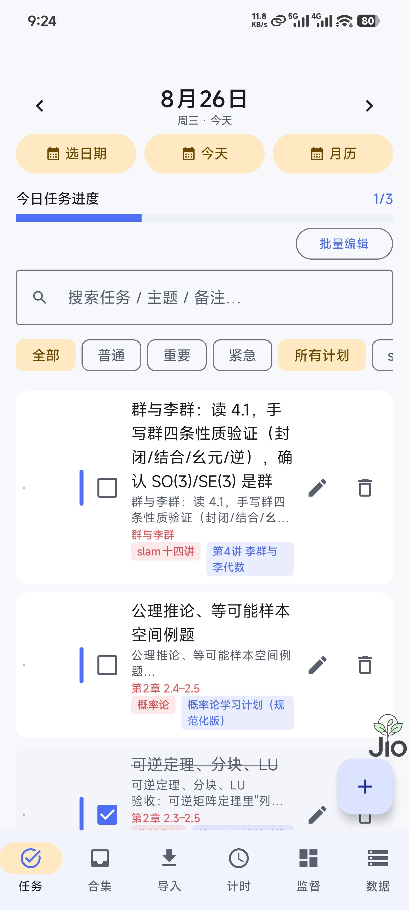
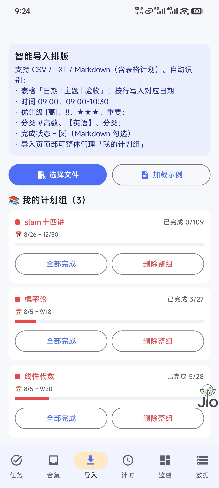
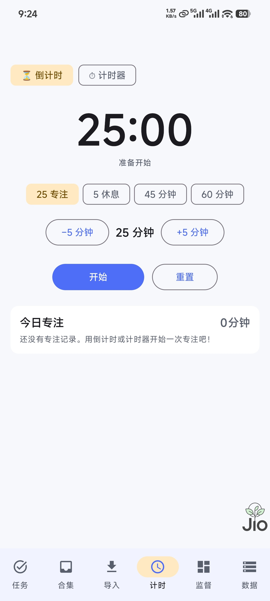
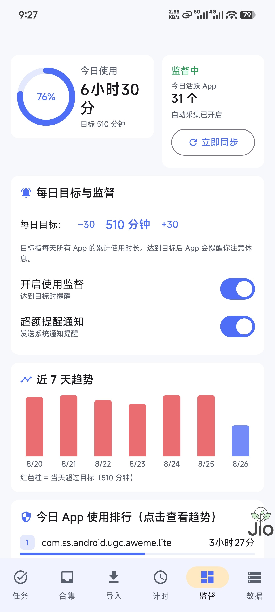

[中文](README.md) | **English**

# Qiaguang Study Schedule Manager · Study Plan Normalizer Skill

[](https://github.com/jie8646/study-plan-normalizer/stargazers)
[](LICENSE)
[](https://github.com/jie8646/study-plan-normalizer/releases/latest)

Turn a "narrative-style" study plan (Markdown) into a standard table that the **Daily Log** app (DiaryApp) can import directly.

## What is this
This skill normalizes free-form study plan documents into the standard Markdown table format recognized by the app's parser, fixing common problems such as dates landing in the wrong place, mis-categorized sections, and over-long titles.

Companion app: **Qiaguang Study Schedule Manager** (formerly Daily Log / DiaryApp). One of its core features — "Import study plan" — requires the standard table format. This skill exists to serve it.

## Screenshots

<p align="center">
  
  
  
  
</p>

<p align="center"><sub>Daily tasks · Plan import · Full-screen focus · Screen-time supervision</sub></p>

## Install
- SkillHub: `skillhub install study-plan-normalizer`
- Manual: copy `SKILL.md` + `normalize_plan.py` into `~/.workbuddy/skills/study-plan-normalizer/`

## Usage
```bash
python normalize_plan.py your-plan.md
# writes your-plan-normalized.md next to it; then pick that file on the app's "Import" page
```
- By default it produces **one task per day** (title = that day's topic; reading / practice / SLAM sub-tasks are merged into the note).
- Add `--detail` for the legacy behavior of one task per sub-item.

## Supported plan structures
| Structure | Tool |
| --- | --- |
| Narrative (`## chapters` + `### ☐ D1 · date · topic` + emoji sub-tasks) | `normalize_plan.py` (included) |
| Probability theory (calendar overview table + 📅 per-day task cards) | `normalize_prob_plan.py` |
| Book, chapter by chapter (one table per chapter) | `normalize_book_plan.py` |

> This slim release ships only the main script `normalize_plan.py`; the two specialized scripts above are available on request.

## App download
The companion app package **`每日日志App-v2.4.0.apk`** (v2.4.0, ~16.6 MB) lives in the `apk/` folder and can be downloaded directly:
- Direct download: [每日日志App-v2.4.0.apk](https://github.com/jie8646/study-plan-normalizer/raw/main/apk/每日日志App-v2.4.0.apk)
- Browse in repo: [apk/ folder](https://github.com/jie8646/study-plan-normalizer/tree/main/apk)

Install it on your Android phone to use the "Import study plan" feature.

> **What's new in v2.4.0** — The focus timer now has an **immersive full-screen mode**: once started, the screen shows nothing but one huge time readout. Tap the screen to reveal "Pause / Exit full screen", which fades out after 3 seconds. The screen stays awake while focusing.

> Note: the app UI is currently **Chinese only**. An English UI is not part of this release.

## Safety
Pure local script: reads input only, writes new files only, no network requests, no delete operations.

## Star History

[](https://star-history.com/#jie8646/study-plan-normalizer&Date)
