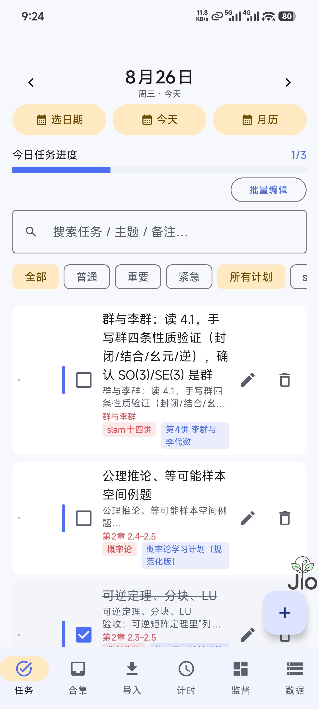
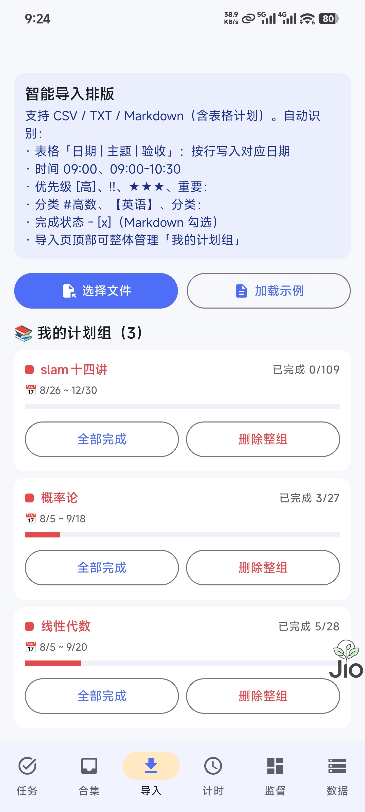
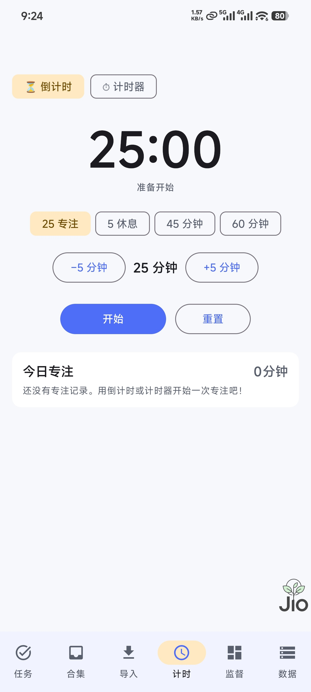
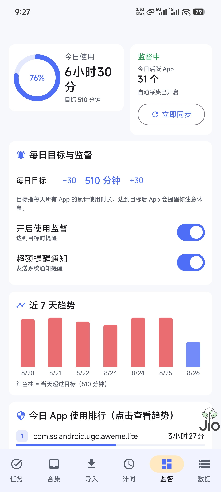

**中文** | [English](README.en.md)

# 恰光学习日程管理App · 学习计划规范化 Skill

[](https://github.com/jie8646/study-plan-normalizer/stargazers)
[](LICENSE)
[](https://github.com/jie8646/study-plan-normalizer/releases/latest)

把"叙事型"学习计划 Markdown 一键转成「每日日志」App（DiaryApp）可直接导入的标准表格。

## 这是什么
本 skill 用于把随手写的学习计划文档，规范化为 App 表格解析器能识别的标准 Markdown 表格，
解决"日期归不到位、分类串错、标题过长"的问题。

配套 App：**恰光学习日程管理App**（原名每日日志App / DiaryApp），其核心功能之一"导入学习计划"
需要标准表格格式。本 skill 就是为它服务的。

## 界面预览

<p align="center">
  
  
  
  
</p>

<p align="center"><sub>每日任务 · 学习计划导入 · 专注全屏 · 使用时长监督</sub></p>

## 安装
- SkillHub：`skillhub install study-plan-normalizer`（或直接搜索 `study-plan-normalizer`）
- 手动：把本仓库 `SKILL.md` + `normalize_plan.py` 放入 `~/.workbuddy/skills/study-plan-normalizer/`

## 用法
```bash
python normalize_plan.py 你的计划.md
# 输出同目录 你的计划-normalized.md，再到 App「导入」页选择即可
```
- 默认**每天一条** App 任务（标题=当日主题，读/练/SLAM 子任务合并进备注）。
- 需要"每个子任务一条"的旧行为时加 `--detail`。

## 支持的计划文档结构
| 结构 | 用法 |
| --- | --- |
| 叙事型（`## 章节` + `### ☐ D1 · 日期 · 主题` + emoji 子任务） | 直接用 `normalize_plan.py`（本仓库已包含） |
| 概率论专用（日历总览表 + 📅 逐日任务卡） | 用 `normalize_prob_plan.py` |
| 整本书逐讲（逐讲表格） | 用 `normalize_book_plan.py` |

> 本精简发布版仅含主脚本 `normalize_plan.py`；其余两个专用分支脚本按需另行获取。

## App 安装包
配套 App 的安装包 **`每日日志App-v2.4.0.apk`**（v2.4.0，约 16.6 MB）放在仓库 `apk/` 文件夹，可直接下载：
- 直接下载：[每日日志App-v2.4.0.apk](https://github.com/jie8646/study-plan-normalizer/raw/main/apk/每日日志App-v2.4.0.apk)
- 在仓库中查看：[apk/ 文件夹](https://github.com/jie8646/study-plan-normalizer/tree/main/apk)
装到手机即可使用"导入学习计划"功能。

> **v2.4.0 更新**：专注计时新增**全屏沉浸模式**——点开始后整屏只显示一枚巨大的时间数字，轻触屏幕唤出「暂停 / 退出全屏」，3 秒自动淡出；屏幕常亮防熄屏。

## 安全说明
纯本地脚本：只读输入、只写新文件，无网络请求、无删除操作。

## Star History

[](https://star-history.com/#jie8646/study-plan-normalizer&Date)
